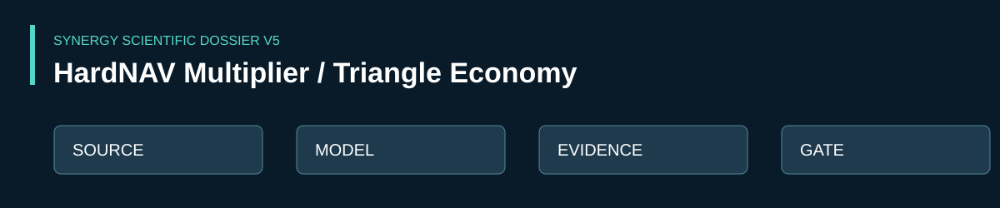

<!-- SCIENTIFIC-V5-2026:START -->

**[Научное досье V5](docs/SCIENTIFIC_DOSSIER_V5_2026.md)** — source inventory, acceptance gates, ограничения и проверки. **Статус:** RESEARCH / SIMULATION. Исторический текст README сохранён ниже.

<!-- SCIENTIFIC-V5-2026:END -->

# SYNERGY HARDNAV MULTIPLIER / TRIANGULAR NON-INFLATIONARY ECONOMY

## Статус

**Research / Simulation / EVM-lab baseline.**

Этот репозиторий фиксирует объединённую архитектуру закрытой экономики SYNERGY: треугольная эмиссия без инфляционного самообмана, 9-pool internal QE-router, HardNAV-accounting, CrossDEX/bridge/fee external-alpha engines, reinvestment и canonical-dividend cash-out.

Главные KPI:

\[
M_H = \frac{HardNAV}{ExternalNetDeposits}
\]

\[
M_D = \frac{CumulativeCanonicalDividendsPaid}{ExternalDollarIn}
\]

Цель — максимизировать **реализуемый canonical HardNAV и реально выплачиваемые canonical-дивиденды на каждый внешний доллар**, не считая внутренний mint прибылью.

---

## 1. Internal money

Внутренние деньги:

- SYNA
- SYNR
- SUSD

Они могут mint/burn контроллером.

> Внутренний mint не считается прибылью и не увеличивает HardNAV сам по себе.

Его роль:

- управление геометрией внутренних пулов;
- маршрутизация капитала;
- повышение utilization;
- восстановление/балансировка внутренних LP.

---

## 2. Canonical assets

Polygon-версия:

- WETH
- WPOL
- USDC

HardNAV считается только по canonical-активам.

---

## 3. Internal 9-pool graph

\`\`\`text
SYNA/WETH
SYNA/WPOL
SYNA/USDC

SYNR/WETH
SYNR/WPOL
SYNR/USDC

SUSD/WETH
SUSD/WPOL
SUSD/USDC
\`\`\`

QE:

\`\`\`text
SYNA / SYNR / SUSD
        |
        | MINT
        v
9 INTERNAL POOLS
        |
        v
WETH / WPOL / USDC
\`\`\`

Ключевые равенства:

\[
Mint \neq Profit
\]

\[
InternalFork \neq ExternalEdge
\]

---

## 4. Реальный источник HardNAV

\[
\Delta HardNAV =
ExternalFees
+ CrossMarketArbitrage
+ BridgeSpread
+ IndependentPriceGap
- Gas
- Slippage
- MEV
- FundingCost
\]

Самоиндуцированное price impact не считается alpha.

---

## 5. HardNAV accounting

\[
HardNAV =
TreasuryCanonicalNAV +
SystemOwnedCanonicalLPNAV
\]

SYNA/SYNR/SUSD не включаются в HardNAV.

---

## 6. V2.1 Capacity-Limited Multiplier Engine

Роутируемый капитал:

\[
Q_t = \min(H_t U_t,\ Capacity_t)
\]

QE повышает utilization:

\[
U_{eff}=U_{base}+QEGain(1-U_{base})
\]

Baseline:

- External deposit = $1
- Gross independent CrossDEX edge = 3%
- Base utilization = 90%
- QE gain = 35%
- Effective utilization = 93.5%
- External fee flow = 0.1% / cycle
- Bridge spread = 0.5%
- Opportunity capacity = 5x initial capital / cycle
- Reinvestment = 100%

Controlled-model results:

| Cycles | HardNAV | M_H |
|---:|---:|---:|
| 10 | 1.212273 | 1.212273x |
| 100 | 6.239175 | 6.239175x |
| 1000 | 87.396675 | 87.396675x |

Это simulated baseline, не обещание рыночной доходности.

---

## 7. Canonical Dividend Multiplier

\[
M_D =
\frac{CumulativeCanonicalDividendsPaid}
{ExternalDollarIn}
\]

Дивиденд считается только после фактического вывода canonical-value из working balance.

Если сохранить $1 principal:

| Cycles | Canonical dividends | Remaining HardNAV | M_D |
|---:|---:|---:|---:|
| 10 | 0.212273 | 1.00 | 0.212273x |
| 100 | 5.239175 | 1.00 | 5.239175x |
| 1000 | 86.396675 | 1.00 | 86.396675x |

---

## 8. Sustainable dividend policy

При baseline capacity=5x найдено рабочее насыщение:

\[
H^* \approx 5.35
\]

Steady modeled canonical dividend:

\[
Dividend^* \approx 0.090175
\]

на цикл на первоначальный внешний $1.

На 1000 циклах:

- working HardNAV ≈ 5.35
- cumulative canonical dividends ≈ 82.046675x initial dollar

---

## 9. Главный optimisation target

\[
\boxed{
\max_{\pi}
\left[
M_D(\pi),\
DividendRate(\pi),\
ResidualHardNAV(\pi)
\right]
}
\]

Ограничения:

- internal mint не считается wealth;
- self-induced edge не считается alpha;
- opportunity capacity конечна;
- edge должен превышать costs;
- есть NO_TRADE;
- dividend считается только после canonical cash-out;
- accounting сходится после каждого цикла.

---

## 10. EVM Lab

Контрольные тесты:

1. CLOSED_INTERNAL_QE — mint не увеличивает aggregate HardNAV.
2. EXTERNAL_FEE_INFLOW — внешний canonical inflow увеличивает HardNAV.
3. INDEPENDENT_TRIANGLE_EDGE — независимый внешний edge может увеличить canonical units.
4. SELF_INDUCED_ROUNDTRIP — round-trip без независимого edge теряет value на fees/slippage.

---

## 11. Polygon Mainnet Fork

Целевой external graph:

\[
WETH/WPOL,\quad WPOL/USDC,\quad WETH/USDC
\]

На fork нужны реальные:

- ERC-20 contracts
- pool contracts
- fee tiers
- V3 slot0
- liquidity
- ticks
- Quoter
- gas
- fixed block number
- snapshot/revert

Сильный PASS возможен только после реального fork execution.

---

## 12. Структура

\`\`\`text
README.md
docs/
  00_SYSTEM_OVERVIEW.md
  01_MATHEMATICS.md
  02_TRIANGULAR_EMISSION.md
  03_HARDNAV_ACCOUNTING.md
  04_EXTERNAL_ALPHA_ENGINES.md
  05_MULTIPLIER_ENGINE_V2_1.md
  06_CANONICAL_DIVIDENDS.md
  07_EVM_LAB.md
  08_POLYGON_FORK_PLAN.md
  09_TEST_RESULTS.md
  10_ASSUMPTIONS_AND_LIMITS.md
sim/
  hardnav_multiplier_v2.py
  canonical_dividend_optimizer.py
contracts/
  AbundanceLab.sol
config/
  baseline.json
\`\`\`

---

## 13. Научная честность

Каждый результат обязан маркироваться как:

- measured
- simulated
- theoretical
- external
- internal
- realized
- unrealized

Главный вопрос:

> какая часть modeled multiplier действительно конвертируется в canonical value при конечной market capacity и реальных издержках?
