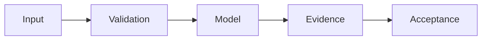

# HardNAV Multiplier / Triangle Economy — SCIENTIFIC DOSSIER V5

**Дата:** 24.10.2026. **Статус:** RESEARCH / SIMULATION.

> Научно-технический source audit. Наличие кода, документации, тестов или workflow не означает фактического запуска, подтверждённой доходности или production readiness.

## Проблема и метод

Реальный код моделирует HardNAV, а не веб-поисковик.

## Проверенные исходники

- [sim/hardnav_multiplier_v2.py](../sim/hardnav_multiplier_v2.py)
- [docs/03_HARDNAV_ACCOUNTING.md](../docs/03_HARDNAV_ACCOUNTING.md)

## Формализация и проверка

Общее требование: отчёты должны связывать claim с commit SHA, данными, тестовыми параметрами и наблюдаемым raw output. 

**Acceptance:** Нулевая внешняя альфа должна давать отсутствие внутренне созданного HardNAV; внешние доходы требуют независимой валидации.

## Ограничения и отрицательные результаты

Не называть модель поисковым движком и не объявлять simulation realized profit.

## Дальнейший инженерный план

1. Проверить версии зависимостей и воспроизводимость команд тестирования.
2. Добавить negative/adversarial controls, документировать failed-case.
3. Зафиксировать фактический CI verdict и привязанный SHA; не повышать зрелость из одного факта существования workflow.
4. Поддерживать границу между R&D, CANDIDATE и DEPLOYED.

Оформление по научному профилю [dlp_solver](https://github.com/Shtenco/dlp_solver) и [synergy_system](https://github.com/Shtenco/synergy_system). Исходный README сохранён.
